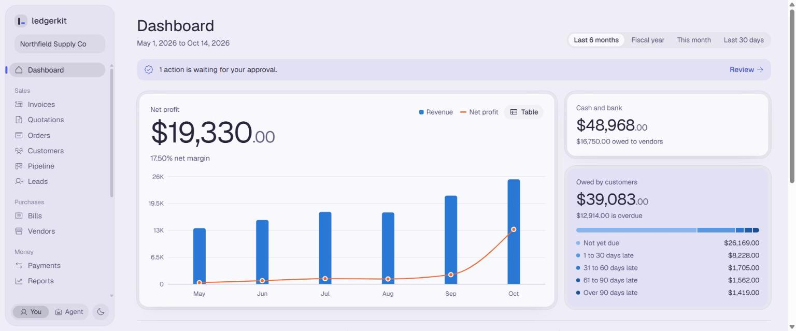
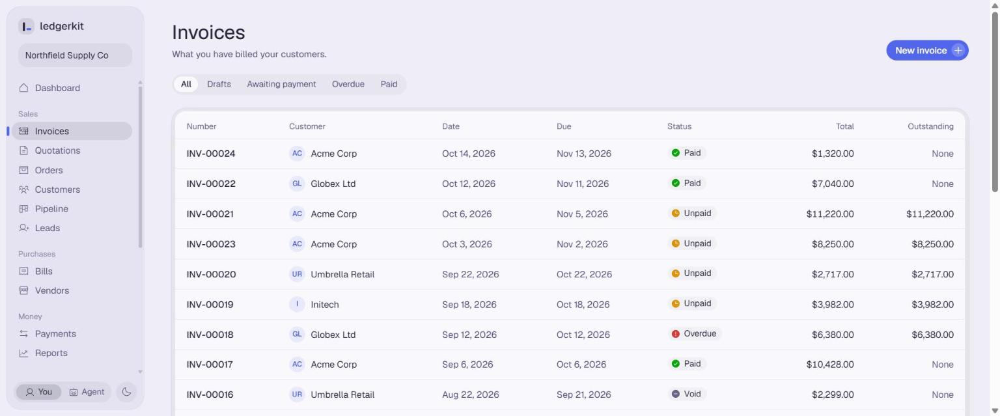
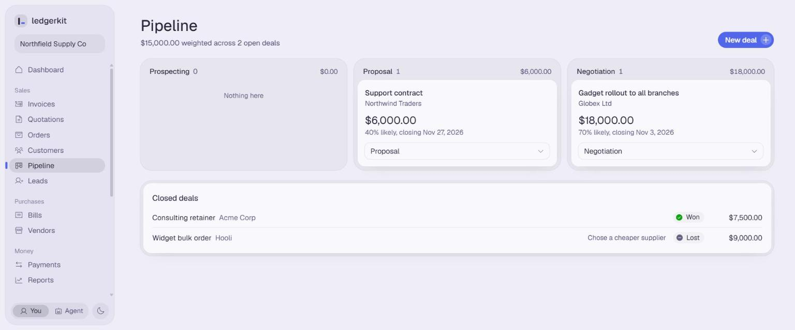
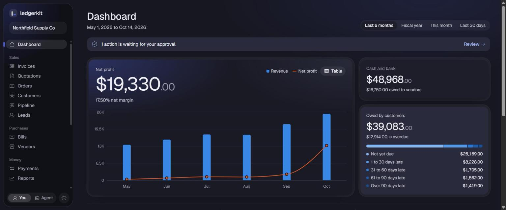

# ledgerkit

An open-source, self-hosted ERP core for small businesses, built so that Claude can operate it safely.

Every operation, from creating an invoice to running a profitability report, is a **tool** with a
name, a description and a JSON Schema. The same tools are served over REST and the command line
today, and are exported in the exact shape the Claude API and MCP expect, so an AI agent can be
attached without redefining anything.

**Status.** The ERP core, the tool layer, the profitability analysis and the web interface are
implemented and tested, and Claude can operate it through the included MCP server (see
[Using it with Claude](#using-it-with-claude)). What comes next is in the
[Roadmap](#roadmap).



## What it does

- **Accounting**: double-entry ledger, chart of accounts, manual journal entries, trial balance,
  profit and loss, balance sheet, period lock date.
- **Invoicing**: sales invoices and vendor bills with tax, payments with partial and automatic
  allocation, voiding by reversal.
- **Sales and CRM**: leads, opportunities and pipeline, quotations, sales orders, order to invoice.
- **Profitability analysis**: margin by item and by customer, monthly revenue and profit trend,
  expense breakdown, break-even, period comparison, receivable and payable aging.

## Quick start

Requires Python 3.12 or later. SQLite is used by default, so there is nothing else to install.

```bash
python -m venv .venv
.venv/Scripts/activate            # Windows;  on macOS/Linux: source .venv/bin/activate
pip install -e ".[dev,mcp]"

# Build the web interface (needs Node 20 or later). Skip this to use only the API and CLI.
cd web && npm install && npm run build && cd ..

ledgerkit init --name "My Company" --currency USD --fiscal-start-month 1
ledgerkit seed-demo               # optional: six months of sample activity
ledgerkit serve                   # app at http://127.0.0.1:8000, API docs at /api/docs
```

Call a tool from the command line:

```bash
ledgerkit tools                                   # list all tools
ledgerkit tool profit_and_loss
ledgerkit tool margin_by_customer --json '{"date_from": "2026-01-01"}'
ledgerkit tool create_customer --file customer.json     # or --file - to read stdin
```

Or over REST:

```bash
curl -X POST http://127.0.0.1:8000/api/tools/ar_aging -H "content-type: application/json" -d "{}"
```

Configuration is read from environment variables or a `.env` file; see `.env.example`. To use
Postgres, install `pip install -e ".[postgres]"` and set `LEDGERKIT_DATABASE_URL`.

## The web interface

`ledgerkit serve` serves the app and the API on one port. The app covers every area: dashboard,
invoices and bills, payments, customers and vendors, quotations and orders, pipeline and leads,
journal, chart of accounts, trial balance, reports, items and tax rates, approvals, the audit log
and settings. It has a light and a dark theme.

It calls only the tool endpoints, so it exercises exactly what an AI agent would use and contains no
business logic of its own. Two parts of it exist to make that visible:

- The **You / Agent** switch in the sidebar shows what an agent experiences. As an agent, posting,
  paying and voiding are held, and appear under Approvals for a person to decide.
- The **Tool console** lists every tool and runs any of them from a form built from its schema.

| | |
|---|---|
|  |  |
|  | |

## How the tool layer works

All tools live in one registry (`src/ledgerkit/tools/`). The registry, not the individual tools,
enforces the rules:

- **Drafts and approval.** An agent can create drafts freely. Anything that changes the books
  (posting, voiding, payments, new accounts and tax rates, the lock date) is held as a *pending
  action* when an agent requests it, and runs only when a human calls `approve_action`. An agent
  cannot approve or reject.
- **One transaction per call.** A call either fully succeeds or changes nothing.
- **Audit log.** Every call that changes data is recorded with who made it, the input and the
  result, including failed and held calls.
- **Actionable errors.** Failures come back as `{"status": "error", "error": {"code", "message"}}`
  with a message that says how to recover, for example *"Journal entry JE-00012 is unbalanced by
  12.50 USD"* or *"Use list_accounts to see valid codes"*.
- **Computed figures.** Analysis tools return numbers calculated in SQL and Python from posted
  records. A model is expected to quote and explain them, never to do the arithmetic.

Who is calling is decided by the interface, not the caller. Over REST it is the bearer token:
`LEDGERKIT_USER_TOKEN` identifies a human, `LEDGERKIT_AGENT_TOKEN` an agent. If neither is set,
every caller is treated as a human, which is only suitable for local use. On the command line,
pass `--actor agent` to see how a call behaves for an agent.

Money is stored as integer minor units and never as floating point. Tools accept and return
amounts as decimal strings such as `"1250.00"` in the company's base currency.

## Using it with Claude

ledgerkit includes an MCP server, so Claude can operate the books directly: answer questions about
profitability, draft invoices and bills, look up what customers owe, and prepare journal entries.
No API key is needed; it works with the Claude apps you already use.

```bash
pip install -e ".[mcp]"
```

**Claude Code**, from any folder:

```bash
claude mcp add ledgerkit --env LEDGERKIT_DATABASE_URL=sqlite:///C:/path/to/ledgerkit.db -- C:/path/to/.venv/Scripts/ledgerkit.exe mcp
```

**Claude Desktop**, in `claude_desktop_config.json` (Settings, Developer, Edit Config):

```json
{
  "mcpServers": {
    "ledgerkit": {
      "command": "C:/path/to/.venv/Scripts/ledgerkit.exe",
      "args": ["mcp"],
      "env": { "LEDGERKIT_DATABASE_URL": "sqlite:///C:/path/to/ledgerkit.db" }
    }
  }
}
```

Use absolute paths for both the command and the database, because the client starts the server
from its own working directory. On macOS and Linux the command is `.venv/bin/ledgerkit`.

Then ask in plain language, for example *"Which customers were least profitable this quarter, and
why?"* or *"Draft an invoice to Acme for 12 widgets."*

Everything that arrives through MCP is treated as an agent:

- It can read anything and create drafts.
- Posting, payments, voids, new accounts and tax rates, and the lock date are **not run**. They are
  queued, and Claude is told to say so. You approve or reject them under **Approvals** in the web
  interface, where you see exactly what would run.
- The approve and reject tools are not offered to it, and are refused if called anyway.
- Every call it makes that changes data is in the audit log as `agent:mcp`.

To build your own agent on the Claude API instead, `ledgerkit export-schemas --out tools.json`
writes every tool as `{"name", "description", "input_schema"}`, the shape the Messages API takes in
its `tools` parameter. Run each tool call with
`registry.call(session_factory, name, tool_input, Actor("agent", "my-agent"))` and return the result.

## Accounting rules to know

- **One company and one currency per database.**
- **Posted entries are immutable.** They are corrected by reversing entries; invoices and payments
  are corrected by voiding them.
- **Cost of goods sold uses standard cost.** Each product has a `standard_cost`. When a sales
  invoice is posted, that cost is debited to Cost of Goods Sold and credited to Inventory. Buying
  products on a vendor bill debits Inventory. Stock quantities are not tracked, so Inventory is a
  value balance only, and margins are only as accurate as the standard costs.
- **Services have no cost of goods sold.** Their costs, such as salaries, are operating expenses,
  so service lines show a 100% gross margin.
- **Break-even** treats cost of goods sold as the only variable cost and all operating expenses as
  fixed.
- **No year-end close.** Income and expense balances are not transferred to Retained Earnings; the
  balance sheet shows the accumulated profit as a single equity line.

## Not implemented yet

Credit notes and refunds, partial invoicing of a sales order, editing or deleting existing records
(a draft document is voided and created again; customers, vendors and items cannot yet be
changed), multi-currency, stock quantities and warehouses, payroll, and user accounts and roles
(access is two shared tokens).

## Development

```bash
pytest                      # backend
ruff check src tests

cd web
npm test                    # frontend unit tests
npm run typecheck
npm run dev                 # app with hot reload on port 5173; needs `ledgerkit serve` running
```

The backend tests check the ledger invariants, the journal lines produced by each document, the
approval gate and audit log, the MCP server through a real MCP client, and that every report
reconciles with the ledger and with the others.
The frontend tests cover exact money arithmetic, the API client and the schema-driven form.

After changing a model, create a migration (this needs a database at the current schema):

```bash
alembic -c alembic.ini revision --autogenerate -m "describe the change"
```

Layout:

```
src/ledgerkit/
  models/      database tables
  services/    business rules; services/ledger.py is the only code that writes journal lines
  analysis/    statements and profitability reports
  tools/       the tool registry and every tool definition
  adapters/    REST, CLI, MCP server and schema export, all generated from the registry
  migrations/  Alembic migrations
  demo.py      demo data, created entirely through the tools
web/src/
  api/         the tool client and data hooks
  design/      design tokens and shared components
  features/    one folder per area of the app
  layout/      app shell, navigation and sign-in
  lib/         money, dates and schema helpers
```

The visual language is adapted from the Mercury analysis in the
[awesome-design-md](https://github.com/VoltAgent/awesome-design-md) collection; the tokens are in
`web/src/styles.css`.

## Roadmap

1. **Done:** ERP core, tool layer, profitability analysis, web interface, MCP server.
2. An assistant built into the web interface, over the same registry.
3. Scheduled profitability reports and alerts.
4. Document automation (reading invoices, bills and bank statements into drafts for review),
   inventory, and editing of existing records.

## Licence

Apache-2.0. See [LICENSE](LICENSE).
